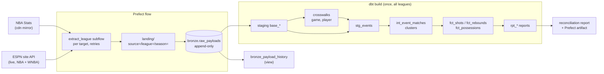
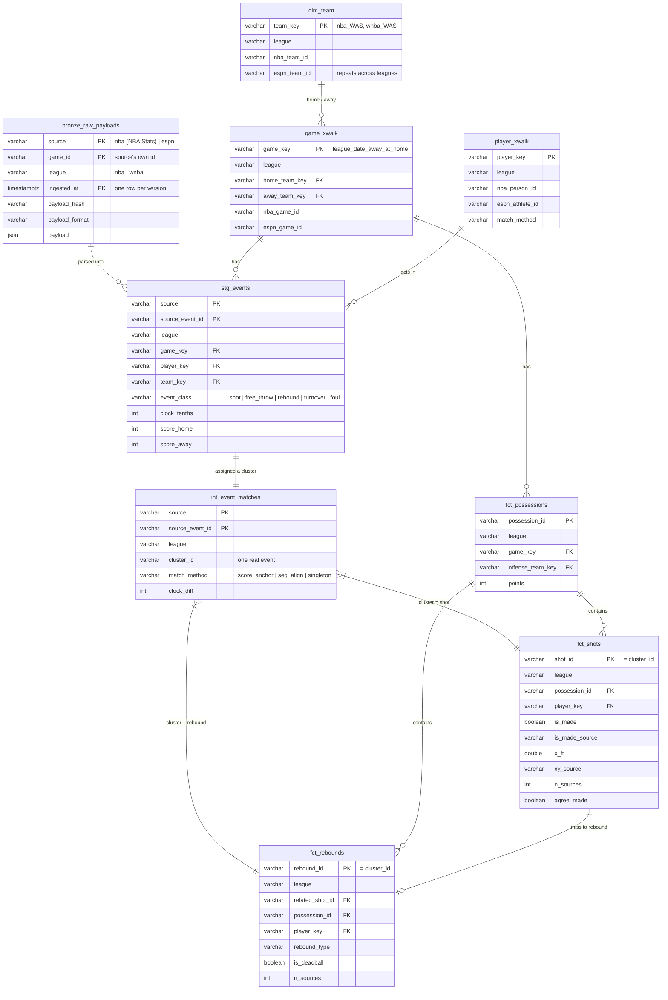
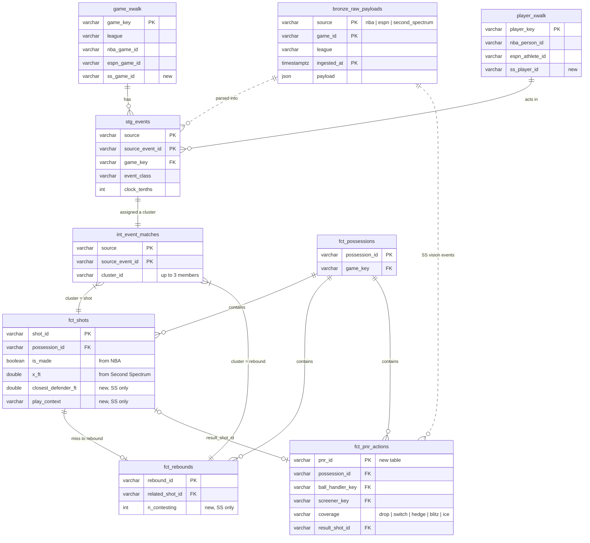

# pbp-unify: one play-by-play from many feeds

A small, runnable answer to the whiteboard question *"design a pipeline that unifies play-by-play
from several providers"*, built on the Wizards' stack: **Prefect, dbt (DuckDB) and a medallion
layout**. It unifies the **NBA** and **ESPN** feeds for every regular-season game of the
**2025-26 NBA season** (1,231 games), plus **ESPN** alone for the **2026 WNBA season**, a
single-source league, into one model of shots, rebounds and possessions, with every value
traceable to the source it came from. **Second Spectrum** is not in this build. Its own
section explains how it would plug in without reshaping the model. Every architecture decision
and its review is in [`docs/decisions.md`](docs/decisions.md).

## Results

| | |
|---|---|
| Games unified | NBA: 1,231, of which 1,230 are in both feeds and the NBA Cup final only in ESPN. WNBA: 329, from ESPN only (ESPN has no summary for two Lynx games) |
| Events per source | NBA, in games both feeds cover: 492,110 in each feed (shots, free throws, rebounds, turnovers and fouls). WNBA: 108,638 from ESPN |
| Paired across sources | NBA: 492,037 (99.99% of each feed's events). WNBA: single-source, so every event is its own cluster |
| Disagreements to review | 293 NBA clusters in 169 games, in `marts.rpt_disagreements`. The Wizards' games are checked case by case and the rest by pattern in [`docs/hand_checks.md`](docs/hand_checks.md) |
| Made-shot points = final score | every game, every source, and in the unified `fct_shots` and `fct_possessions` (each is a dbt test), apart from 17 reviewed ESPN errors in 12 games listed in `seeds/known_data_issues.csv` |
| Matcher, real data | **7** made baskets left unpaired (in 2 games), all of them shots ESPN doesn't have, so none is a matcher miss; score-only anchors leave 167 (in 73 games), the clock window 13 (in 7) |
| `dbt build` | 91 nodes (23 models, 4 seeds, 64 tests) over both leagues, all green: about 3 minutes for the full build, under a minute for `make team` |

Full numbers: [`reports/matcher_evaluation.md`](reports/matcher_evaluation.md) (NBA games) and
[`reports/reconciliation.md`](reports/reconciliation.md) (per league). Both are regenerated on each run.

## Quick start

```bash
make all      # venv, Prefect flow (extract -> bronze -> dbt build -> report), evaluation,
              # for every 2025-26 NBA game (NBA feed + ESPN) and every 2026 WNBA game (ESPN)
make team     # the same for one team per league, by default the Wizards and the Mystics
```

Everything runs locally on DuckDB: no cloud account, credentials or cost. Needs Python 3.11+ and
internet access. `make all` is the build behind the numbers above. It downloads about 20 MB of NBA
mirror data, makes about 1,600 ESPN API calls and builds a `data/pbp.duckdb` of about 2 GB. It
needs about 4 GB of disk, peaks near 12 GB of memory in `dbt build`, and takes about 10-25 minutes
depending mostly on the ESPN downloads. `make team` takes about 2 minutes and fits any laptop.
Dependencies install from `requirements.lock`, which pins every package. `make clean` drops dbt's output and the landing
files but keeps bronze, the only record of payload history; `make clean-all` deletes everything.
Other targets:

| | |
|---|---|
| `make flow` | Re-run the flow. Landed files are reused, so only new games are fetched. `NBA_TARGET` and `WNBA_TARGET` pick a team instead of `ALL`, e.g. `make flow NBA_TARGET=nba:2025-26:BOS`. |
| `make flow-nba`, `make flow-wnba` | One league's target only. |
| `make dbt` | `dbt build` only. `make dbt LEAGUES=wnba` rebuilds and tests only the WNBA rows. |
| `make eval` | Matcher evaluation, written to `reports/matcher_evaluation.md`. |
| `make docs` | `dbt docs generate` (lineage graph and column docs). |
| `python flows/pbp_flow.py --target nba:2025-26:WAS --games 401809939 --refresh-recent-days 3` | Flow parameters: targets (repeatable), ESPN game list, refresh window. |

Then query it, for example with `duckdb data/pbp.duckdb`:

```sql
select p.display_name, count(*) filter (where s.is_made) as fgm, count(*) as fga
from marts.fct_shots s join crosswalks.player_xwalk p using (player_key)
where s.team_key = 'nba_WAS' and not s.is_free_throw
group by 1 order by fga desc limit 5;
```

## Architecture



One run of `pbp_flow` takes a list of targets (`league:season:team`, by default
`nba:2025-26:ALL` and `wnba:2026:ALL`). Team `ALL` means the whole league: ESPN's schedules are
per team, so the flow merges every team's and lists each game once, while the NBA mirror ships the
whole league and simply skips the team filter. Each target is extracted in its own
`extract_league` subflow: one task per ESPN game, so a failed call retries on its own, and for the
NBA one task per season for the mirror, which ships a season per file.
A game that still fails after its retries is recorded, not raised: everything that landed is
loaded, built and reported, and the run then fails listing what didn't land. Loading,
`dbt build` and the report run once, because they cover the whole project. Diagram source:
[`docs/architecture.mmd`](docs/architecture.mmd).

| Layer | Models | Notes |
|---|---|---|
| Bronze | `bronze.raw_payloads`, `bronze_latest`, `bronze_payload_history` | One payload per (source, game, version), with `source, league, season, game_id, payload_format, payload_hash, ingested_at`. Append-only. ESPN responses are stored verbatim; NBA mirror games are that game's rows cut from the season CSV, as JSON with every value kept as a string. |
| Silver: staging | `base_*`, `stg_nba`, `stg_espn` → `stg_events` | One schema for both feeds: `clock_tenths`, `event_class`, `is_made`, `shot_value`, `ft_number`, `rebound_type`, `is_team_rebound`, `is_deadball`, `player_key`, `team_key`, `x_ft`/`y_ft`, scores after the event. |
| Silver: crosswalks | `game_xwalk`, `player_xwalk`, seeds `dim_team`, `source_coverage`, `event_type_map`, `known_data_issues` | Canonical keys and reference data. |
| Silver: matching | `int_event_matches` (dbt Python model), `int_clusters` | Every source event gets a `cluster_id`. |
| Gold | `fct_shots`, `fct_rebounds`, `fct_possessions`, `rpt_source_agreement`, `rpt_disagreements`, `rpt_coverage` | One row per real event, with field-level source precedence. |



## How matching works

A **cluster** is one real thing that happened on the court. `cluster_id` is the key the matcher
assigns to it, and every source's row for that event points to it. Real rows from WAS at MIL,
2025-10-22, Q1:

| cluster_id | source | event | player | clock | x, y (ft) | score | method |
|---|---|---|---|---|---|---|---|
| `…:N14` | nba | `MISS M. Turner 27' running 3PT` | Turner | 11:30.0 | 19.5, 20.0 | 0-0 | seq_align |
| `…:N14` | espn | `Myles Turner misses 28-foot three point shot` | Turner | 11:30 | 20, 20 | 0-0 | seq_align |
| `…:N15` | nba | `K. Middleton REBOUND (Off:0 Def:1)` | Middleton | 11:27.0 | | 0-0 | seq_align |
| `…:N15` | espn | `Khris Middleton defensive rebound` | Middleton | 11:27 | | 0-0 | seq_align |
| `…:N18` | nba | `A. Green 3PT (3 PTS) (M. Turner 1 AST)` | Green | 11:06.0 | -23.2, 1.1 | 3-0 | score_anchor |
| `…:N18` | espn | `AJ Green makes 23-foot three point jumper` | Green | 11:06 | -23, 1 | 3-0 | score_anchor |

`fct_shots` then has one row per cluster, with `n_sources = 2` and agreement flags. Matching runs
per game in two steps (`src/pbp/matching.py`):

1. **Score anchors.** A made shot or free throw is the only event that changes the score, and
   scores only go up. So "the basket that made it 3-0 in Q1" is the same event in both feeds,
   whatever their clocks say. These pairs are fixed first and split the game into short segments.
2. **Sequence alignment between anchors.** Inside a segment, each feed has a few misses,
   rebounds, turnovers and fouls. They are aligned the way `diff` aligns two files: an
   order-preserving pairing that maximizes a similarity score (same type, same player, same
   free-throw number, close clock), where skipping an event is allowed. Each event class is
   aligned separately, because only the order within a class carries information (two rebounds
   in a row).

Anything left unpaired becomes a **singleton** cluster ("only one feed saw this"). NBA is the
pivot, so a cluster id is built from the NBA action number (`game_key:N123`) and stays the same
across reruns. A cluster only ESPN has gets `game_key:E<play id>`.

## Design decisions and trade-offs

Every architecture decision, what it was weighed against and a verdict from the league-wide
review is in [`docs/decisions.md`](docs/decisions.md). The ones that shaped the model most:

**Score anchors must key on more than the score.** The first version keyed anchors on the score
alone. Real data broke it. In MIN at WAS on 2026-01-04, ESPN's running score has Minnesota 2
points behind NBA's for part of the 2nd quarter (both catch up by the final). Inside that stretch,
the score after an ESPN Gobert dunk equals the score after an NBA Middleton three. Score-only
anchors paired them, which left 8 made baskets unpaired and double-counted across 3 games. Anchors
now also key on scoring team and points, and must pass the clock check. That brought unpaired
made baskets on the Washington games to 0. The league-wide run found one more collision: the NBA
feed can give free throws it logs out of order (a technical between two shots) a later running
score, so "the free throw that made it 96-94" was Queta's in one feed and Pritchard's in the
other. Anchors therefore never pair two different players either; the alignment step pairs such
events afterwards. Across all 1,231 NBA games the 7 made baskets still unpaired are shots ESPN
doesn't have at all. `assert_unified_points_equal_final_score` is the test that catches this
class of bug.

**Sequence alignment over clock windows.** A clock window ("same type within ±2 s") looks fine
on clean data: NBA and ESPN clocks agree to within 0.1 s on almost every event, which suggests
ESPN builds its feed from the league's data. Even so, across the 1,231 NBA games it leaves 13 made
baskets unpaired (and double-counted) in 7 games, against 7 for alignment, which are all shots
ESPN lacks and so stay unpaired under any matcher. It also has nothing to fall back on when a
feed's clock or order drifts. In basketball terms: a miss, an offensive rebound, a putback miss
and a second rebound can all happen in two seconds, and only order tells the two rebounds apart.

**Order events by clock, not by feed sequence.** ESPN sometimes appends late-entered plays out of
order. In one game a foul at 5:22 is listed before a turnover at 5:49. Sorting by game clock
first, with each feed's own sequence breaking ties within the same tenth of a second, fixed every
such case. A per-period pass over leftover events catches anything that lands on the wrong side
of an anchor.

**Field-level precedence with `*_source` columns.** Within a cluster, each field comes from NBA
when NBA has it, otherwise ESPN, and a `*_source` column records which. The rule is "official
league feed first". It matters in practice: for a missed end-of-quarter heave, the NBA feed logs
only a team-level `heave` action, so heaves don't count against player shooting. ESPN logs it as
a player's shot. The unified row takes the player and coordinates from ESPN
(`player_key_source = 'espn'`) and everything else from NBA. A plain coalesce would hide
disagreements, so gold keeps `agree_made`, `agree_player`, `agree_value` and `xy_diff_ft`, and
`rpt_disagreements` lists every case.

**Late corrections.** Bronze is append-only. `payload_hash` covers every part of a payload staging
reads and nothing else (for ESPN: plays, box score and the header's scores, not odds or news,
which change between pulls), so a re-pull writes a new row only when a stat actually changed.
`bronze_latest` is the current version per game and `bronze_payload_history` every version with
the window it was current in; both are views, so payloads are stored once. A snapshot would only
duplicate an append-only table. Landing files are overwritten on refresh to save local disk, so
bronze is the record of history and `make clean` keeps it; in production, landing would be
versioned (a new file only when the hash changes) so bronze can always be rebuilt from it.
`refresh_recent_days` re-pulls recent games; in mirror mode a refresh downloads the season file
again only when its ETag has changed.

**Tests encode basketball, and known source errors are data.** Beyond `unique`, `not_null` and
`relationships`, singular tests check that:
- every rebound follows a miss (except dead-ball team rebounds),
- made-shot points equal the final score for each source, for the unified table and summed over
  possessions,
- NBA and ESPN attempt counts are within a tolerance,
- possessions alternate (the two teams' counts differ by at most 1 per period),
- no league appears from a source that doesn't cover it,
- every event type is mapped,
- the court-frame flip matches NBA's own half-court coordinates to within 0.5 ft,
- every player resolves.

When a test finds a genuine source error, the fix is a row in `seeds/known_data_issues.csv` with a
note. The test isn't loosened. There are 17 entries across 12 games, all ESPN errors, each
hand-checked:
- in 8 games (6 NBA, 2 WNBA) ESPN's running score ends 1-3 points short of its own made baskets
  and its header final; in the NBA ones its events match the NBA feed play for play;
- in DEN at MIN on 2025-11-15, ESPN repeats a stretch of Q3 plays with shifted clocks;
- in OKC at NOP and LAC at CHI, ESPN is missing made field goals;
- in CLE at WAS, ESPN marks a Tre Johnson free throw as made while its own running score doesn't
  move. NBA has it as missed. ESPN's header says 115-148 and both play-by-play feeds end 114-148.

Event types work the same way: a code missing from `seeds/event_type_map.csv` fails the build,
and the league-wide run added 16 (lane and excess-timeout violations, rare turnover types,
ESPN's untyped "No Shot (Default Shot)", which is a real shot). ESPN's "No Turnover" is likewise
an untyped turnover, not the absence of one; mapping it as `ignore` had hidden 10-second
free-throw violations from ESPN's side.

**Player matching is per game and team.** NBA's play-by-play carries only short names
(`K. Middleton`). That happens to be ESPN's `shortName` format, so 570 of the 582 NBA players
with events match on it directly. The other 12 need a last-name pass (`P.J.` vs `PJ`) or a token
pass.
The token pass handles NBA's `G. Jackson` for ESPN's `GG Jackson` (Jaren Jackson Jr. is on the
same team) and NBA's family-name-first `Yang` for ESPN's `Y. Hansen`. Matching within a game and
team means two players with the same name on different teams never collide. Another 9 appear
only on ESPN's game rosters without a single play (injured players such as Damian Lillard) and
stay `espn_only`, as every WNBA player does.
Each player's final match is the ESPN athlete they matched in the most games, which settles
cases a single game can't: Seth and Stephen Curry are both "S. Curry" on Golden State, and in 3
of Seth's 10 games the per-game pass can't tell them apart (his `match_confidence` is 0.7, the
only one below 1). The game key is readable (`nba_20251022_WAS_at_MIL`) rather than a surrogate,
at a known cost: a tip-off corrected across midnight Eastern, or a franchise changing tricode,
would change the key and every `cluster_id` built on it.

**The WNBA is a single-source league.** The WNBA's official stats have no public API, so the WNBA
comes from ESPN alone, which is how college would arrive too
([D5](docs/decisions.md#d5-the-wnba-from-espn-only-a-single-source-league)). Nothing in the model
is special-cased for it:
- every WNBA event is a singleton cluster (`n_sources = 1`, `match_method = 'singleton'`), and the
  `nba_*` columns are null;
- possessions are derived from ESPN's event order (below), with `boundary_source = 'espn'`;
- the agreement and disagreement reports cover only games both feeds have, so single-source games
  don't flood them;
- ESPN's errors can only be caught against ESPN itself: made baskets against its own running
  score and header final. That is the real cost of one source.

The one cross-league trap is ESPN team ids, which repeat across leagues (16 is the Mystics and the
Timberwolves), so every ESPN team join also matches on league.

**Why the matcher is a dbt Python model.** The alignment is a small dynamic program per segment:
clear in about 40 lines of Python, unreadable in SQL. It lives in `src/pbp/matching.py` and is
shared with the evaluation, so what's evaluated is exactly what runs. Everything else is SQL.

**Possessions come from the NBA feed's `possession` field.** It equals the acting team on 100% of
the 384,430 field goals, rebounds and turnovers of 2025-26. In games only ESPN covers (every WNBA
game, the NBA Cup final), ESPN has no such field, so the team with the ball is set by shots,
non-technical free throws, rebounds and turnovers and carried forward over fouls; the 2026 WNBA
season comes out at 80.3 possessions per team per game, in line with league pace. In NBA-feed
games, events only ESPN recorded take their team's possession at that clock; a technical free throw shot before a period's first possession
belongs to none, in either feed, and the possession-points test adds it back separately. A
possession is a run of actions with the same team, so an offensive rebound continues the
possession. Tests check that the two teams' possession counts
differ by at most 1 per period, and that possession points add up to the final score. Possession
ids are positional (`game_key:P001`, …): a correction that inserts an action shifts every later id
in that game, which is harmless while gold is rebuilt in full. Assists, steals and blocks are out
of scope: NBA logs blocks and steals as separate actions (mapped `ignore`) and ESPN embeds them as
a second participant. The next step is attributes on the parent event (`assist_player_key` on
shots, `steal_player_key` on turnovers, `block_player_key` on missed shots).

**Partitioning and scale.** Play-by-play is small: about 500k events per source per NBA season.
The one pinch point is memory: parsing a season of raw JSON payloads in staging peaks near 12 GB
in DuckDB, so dbt runs one model at a time (`threads: 1`), which still builds both leagues in
a few minutes (about 1 on a 24 GB Mac, about 3 on a 15 GB Linux machine). The unit of work is the game: extract, match and rebuild one game at a time, with no
cross-game joins. Landing files use hive-style folders (`source=/league=/season=`), which DuckDB
reads natively. In a warehouse I'd partition silver and gold by league and season and cluster by
game. Real tracking data (about 800k rows per game at 25 Hz) is where partitioning by game date
becomes essential.

**League-scoped builds.** Leagues never share a game, so each league is a slice that can be
rebuilt on its own. `dbt build --vars '{leagues: [wnba]}'` (or `make dbt LEAGUES=wnba`) turns
every model into an incremental one: a pre-hook deletes the WNBA rows, the model reads its inputs
through `scoped()` (only WNBA rows) and appends its output, and tests check only WNBA rows. NBA
rows are left as they are. Without the var, every model is a full table, as before. The flow
picks the scope itself: a run whose targets touch only some of the loaded leagues builds just
those, and `make flow` (both) does a full build. A scoped build produced the same rows as a
full one when checked table by table with a content hash (a one-off check; committing it as a
script is in the backlog). The Python matcher stays a full table
and carries the other leagues' rows over itself, because dbt-duckdb's incremental path for
Python models fails on a local database. The logic is in `dbt/macros/league_scope.sql`.
A full build is still the safe choice after changing a model, since a scoped build only reruns
the new logic on its own league.

**Coverage gaps are explicit.** `seeds/source_coverage.csv`, checked live on 2026-10-16:
- ESPN covers the NBA, WNBA and men's and women's college basketball.
- The official feed used here covers the NBA only (NBA Stats, through a community mirror). The
  WNBA's official stats have no public API, so the WNBA is ESPN only.
- Second Spectrum covers no college games.

A test fails if a league appears from a source that doesn't cover it. College games would arrive
ESPN-only, with `n_sources = 1` (after adding those teams to `dim_team`). Clocks are stored as
time left in the period, so two 20-minute halves need no special handling.

## What is real

Everything in the database is real play-by-play:

| Source | How it is fetched | Status here |
|---|---|---|
| ESPN | Live: `site.api.espn.com/apis/site/v2/sports/basketball/{nba,wnba}/summary?event={id}` (undocumented public API) | Tested. Every 2025-26 NBA and 2026 WNBA game pulled live. ESPN answers 404 for two completed 2026 Lynx games (May 29 at CHI, June 1 at PHX); the extractor logs and skips them, so they are missing. |
| NBA | Mirror of cdn.nba.com liveData, [shufinskiy/nba_data](https://github.com/shufinskiy/nba_data) `cdnnba_2025` (one CSV per season, values kept as strings) | Tested. All 1,230 regular-season games. The NBA Cup final isn't in it, so only ESPN's copy is loaded. |

Every request the pipeline sends identifies itself honestly (`pbp-unify portfolio project`). There
is no live NBA mode: cdn.nba.com and stats.nba.com refuse scripted requests (403 or timeout, also
from a home connection on 2026-10-18), and getting past that means disguising requests. In
production the mirror is replaced by the league's licensed feed (see the next section).

There is no synthetic data: every number here comes from the games as the sources published
them. No raw third-party data is committed (`data/` is git-ignored), and the providers' terms
apply.

## Swapping in a live feed or a new source

Each source is one extractor that writes one file per game to the landing zone, plus a
`payload_format` that staging knows how to parse:

1. Write `extract_<source>.py`: fetch and save as-is. `load_bronze` takes care of hashing and
   versioning.
2. Add a `base_<source>_*` model for the new `payload_format`, and a `stg_<source>` model mapping
   it to the `stg_events` columns.
3. Add the source's ids to the crosswalks and its type codes to `event_type_map`.

The matcher doesn't change. Gold's field precedence is written per source, so a new source adds
its columns there (see the Second Spectrum section). Replacing the NBA mirror with a licensed
league feed is this recipe with nothing downstream changing: a new `payload_format` and a branch in
`base_nba_actions`.

## Adding Second Spectrum

Second Spectrum (Genius Sports) is the league's optical tracking provider. It isn't public: it's
delivered under enterprise agreements, reportedly as JSONL event and tracking files plus a
`_meta.json`. It adds what neither feed here has: ball screens and pick-and-roll coverage (drop,
switch, hedge, blitz, ice), drives, closeouts, defender distance and rebound positioning. Adding it
changes the model like this:



- **A third source in the same clusters.** `stg_ss` maps its shot, rebound and other events to
  `stg_events`. The matcher pairs it against the NBA pivot exactly as it pairs ESPN, so clusters
  get up to three members, for events the official feed has. An event the official feed missed
  can only match through the pivot, so ESPN's and Second Spectrum's copies of it would stay two
  singletons; a third source is the point to match non-pivot sources with each other.
- **Vision-only fields join through the cluster.** `closest_defender_ft`, `is_contested` and
  `play_context` on `fct_shots`; contest fields on `fct_rebounds`. Coordinates would move to
  Second Spectrum in the precedence rule (official result from NBA, location from tracking).
- **A new `fct_pnr_actions` table.** Ball handler, screener, both defenders, coverage and result,
  attached to `fct_possessions`, with `result_shot_id` pointing at the shot cluster it produced.
- **The tables don't change; some code does.** Bronze, staging, clusters, possessions and the
  shot→rebound link keep their shape, and the `int_clusters` pivot takes the new source as one
  list entry. The field precedence in `fct_shots`, `fct_rebounds` and `rpt_disagreements` is
  written per source, though, so with a third source it should become data (a seed of source
  priority per field) instead of more `coalesce` branches.

## Repo layout

```
flows/pbp_flow.py            Prefect flow
src/pbp/                     extract_nba.py, extract_espn.py, load_bronze.py, matching.py,
                             evaluate.py, report.py, clean.py
dbt/models/staging           bronze_latest, base_* (typed per source), stg_nba, stg_espn, stg_events
dbt/models/crosswalks        game_xwalk, player_xwalk
dbt/models/intermediate      int_event_matches (Python), int_clusters, possessions
dbt/models/marts             fct_shots, fct_rebounds, fct_possessions, rpt_*
dbt/seeds  dbt/tests  dbt/macros
docs/                        decision log, hand-checked disagreements, architecture diagram source
reports/                     generated evaluation and reconciliation reports
```

## Next steps

The decision log ends with a [backlog](docs/decisions.md#follow-up-backlog) of agreed changes not
yet made, mostly tests. Beyond it:

- **Video verdicts on credit disagreements.** The league-wide disagreements are reviewed by
  pattern; about 95 teammate-credit cases still need video to say which feed is right.
- **Game-scoped builds.** The same pattern as the league scope, one level down: rebuild only the
  games whose payload hash changed, so a nightly run touches a handful of games. Whole-game
  rebuilds are safe because a correction can shift clusters and possessions for the rest of a
  game.
- **Backfills.** Run the flow per season as a Prefect deployment with a concurrency limit per API
  (the `espn-api` tag is already on the extract task).
- **Alerting.** A Prefect automation on flow failure, plus a dbt source-freshness check on
  `ingested_at` and a threshold on new rows in `rpt_disagreements`.
- **Real tracking data.** Add Second Spectrum as above, with event-to-frame indexing for the
  tracking files, partitioned by game date.
- **More leagues.** College through ESPN (coverage already verified). Play-by-play stays
  ESPN-only there, so the reports should show single-source coverage, not treat it as low
  agreement.
- **A second WNBA source.** A licensed WNBA feed would make the WNBA a two-feed league like the
  NBA, with nothing in the model changing. Backfilling earlier seasons through ESPN is one target
  each.
